# TP3 — Les sockets TCP : client-serveur multithread

**Module :** Développement d'applications réparties  
**Activité 3-1 :** Calculatrice client/serveur avec gestion de plusieurs clients  
**Langage :** Java (JDK 8 ou supérieur)  
**Port TCP :** `1234`

---

## 1. Objectifs

L'objectif de ce TP est d'améliorer l'application client/serveur en permettant au serveur de traiter plusieurs clients simultanément grâce aux threads Java.

Le client saisit une opération arithmétique, vérifie sa syntaxe, puis transmet les deux nombres et l'opérateur au serveur. Le serveur effectue le calcul et renvoie le résultat au client.

Les opérations prises en charge sont :

- Addition : `+`
- Soustraction : `-`
- Multiplication : `*`
- Division : `/`
- Fin de la communication : `quit`

## 2. Environnement utilisé

- Java JDK 8 ou supérieur
- Eclipse, IntelliJ IDEA ou Visual Studio Code
- Sockets TCP : `ServerSocket` et `Socket`
- Flux de texte : `BufferedReader` et `PrintWriter`
- Threads Java : `Thread`
- Expressions régulières : `Pattern` et `Matcher`

## 3. Organisation du projet

Le projet contient trois classes principales :

```text
TP3/
├── src/
│   ├── ClientPackage/
│   │   └── Client3_1.java
│   └── ServerPackage/
│       ├── ServerMT_3_1.java
│       └── ClientProcess3_1.java
├── captures/
│   ├── serveur_attente.png
│   ├── client_connecte.png
│   ├── resultat_calcul.png
│   ├── plusieurs_clients.png
│   └── fin_communication.png
└── README.md
```

> **Captures d'écran :** les images ci-dessous sont des emplacements à compléter. Après avoir exécuté le programme, prenez vos propres captures d'écran, placez-les dans le dossier `captures/` avec les noms indiqués, puis ajoutez-les au dépôt GitHub.

## 4. Fonctionnement de l'application

### 4.1 Côté client — `Client3_1.java`

1. Le client se connecte au serveur sur `localhost`, port `1234`.
2. Il demande à l'utilisateur de saisir une opération, par exemple `55 * 25`.
3. Il vérifie la syntaxe de l'opération grâce à une expression régulière.
4. Si la saisie est invalide, un message d'erreur est affiché et aucune donnée n'est envoyée.
5. Si la saisie est valide, le client envoie trois lignes : le premier nombre, l'opérateur et le deuxième nombre.
6. Il lit la réponse envoyée par le serveur et l'affiche.
7. La saisie `quit` permet de terminer la communication.

La validation de la syntaxe côté client permet d'éviter d'envoyer au serveur une opération qui ne respecte pas le format attendu.

### 4.2 Côté serveur — `ServerMT_3_1.java`

1. Le serveur ouvre le port TCP `1234` avec `ServerSocket`.
2. Il attend une connexion avec la méthode `accept()`.
3. À chaque connexion, il incrémente le numéro du client et affiche son adresse distante.
4. Il crée un objet `ClientProcess3_1` pour cette connexion.
5. Il démarre le traitement avec `start()`, puis revient immédiatement à l'attente d'un autre client.

Le serveur principal s'occupe donc d'accepter les connexions. Le traitement des opérations est confié à un thread séparé pour chaque client.

### 4.3 Traitement du client — `ClientProcess3_1.java`

1. Le thread récupère les flux d'entrée et de sortie de la socket qui lui a été attribuée.
2. Il lit le premier nombre, l'opérateur et le deuxième nombre.
3. Il convertit les nombres en valeurs `double`.
4. Il appelle la méthode `calculer()` pour réaliser l'opération.
5. Il envoie le résultat au client avec `PrintWriter.println()`.
6. Il continue à lire les opérations suivantes jusqu'à recevoir `quit` ou jusqu'à la fermeture de la connexion.
7. La socket de ce client est fermée dans le bloc `finally`.

La méthode `calculer()` gère les quatre opérations arithmétiques. En cas de division par zéro, elle renvoie le message `Erreur : division par zéro impossible`.

## 5. Protocole de communication

Le client et le serveur échangent des chaînes de caractères, une donnée par ligne.

Pour l'opération `55 * 25`, le client envoie :

```text
55
*
25
```

Le serveur lit les trois lignes dans le même ordre, calcule le résultat et renvoie une réponse, par exemple :

```text
55.0 * 25.0 = 1375.0
```

Le client affiche ensuite :

```text
Résultat : 55.0 * 25.0 = 1375.0
```

Le protocole exige que les deux programmes respectent le même ordre d'envoi et de lecture. Le `PrintWriter` est créé avec l'option `true`, ce qui active le vidage automatique du flux après `println()`.

## 6. Captures d'écran des résultats

### 6.1 Serveur en attente d'un client

Le serveur est lancé en premier et attend une connexion sur le port `1234`.

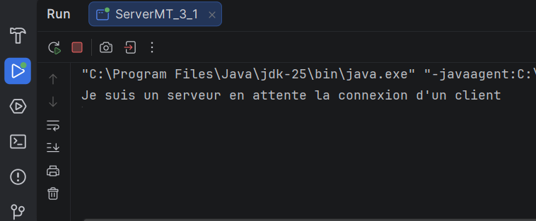
### 6.2 Connexion du client

Le client se connecte au serveur et affiche l'invite de saisie d'une opération.

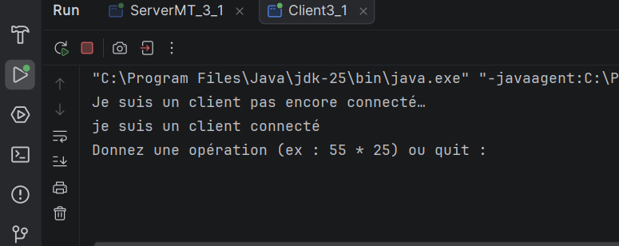

### 6.3 Exemple : multiplication de 55 par 25

Le client saisit `55 * 25`. Le serveur effectue le calcul et renvoie le résultat `1375.0`.

### client :
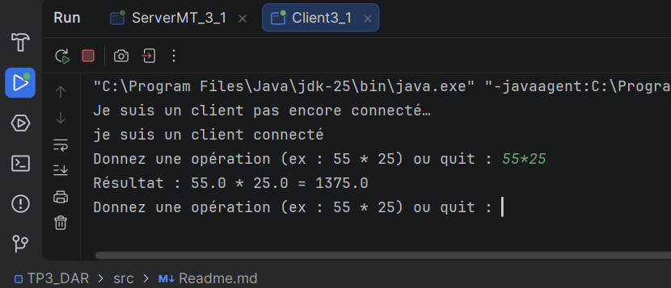
### Serveur
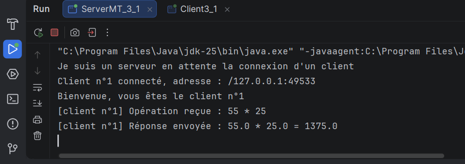
### 6.4 Connexion de plusieurs clients

Le serveur accepte plusieurs connexions et attribue un numéro d'ordre à chaque client. Chaque connexion est prise en charge par un thread distinct.

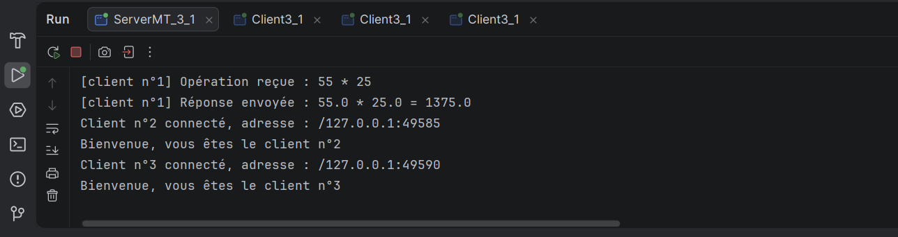
### 6.5 Fin de la communication

Lorsque l'utilisateur saisit `quit`, le client envoie la commande de fin et ferme sa connexion. Le serveur termine le traitement du client concerné.

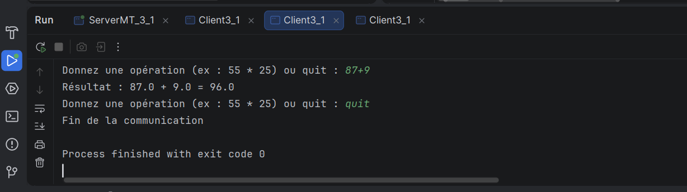
### 6.6 resultat de serveur au cours de la comminucation :
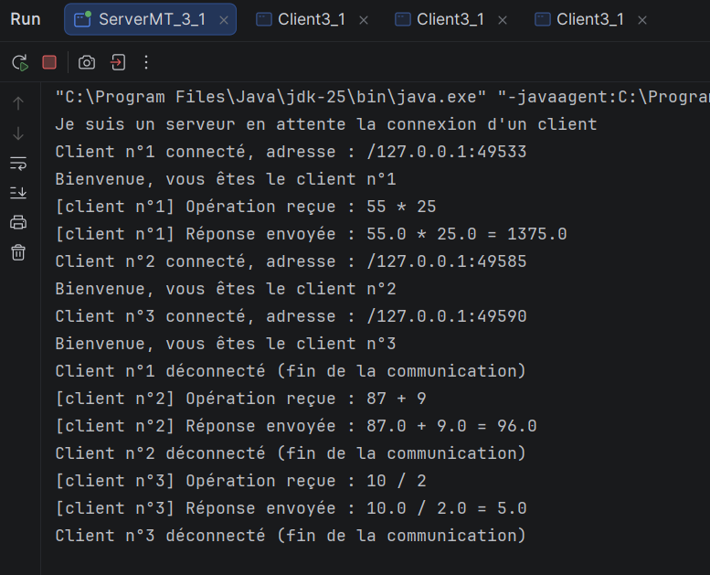
## 7. Tests à réaliser

| Saisie | Résultat attendu |
|---|---|
| `55 * 25` | `55.0 * 25.0 = 1375.0` |
| `10 + 5` | `10.0 + 5.0 = 15.0` |
| `10 - 5` | `10.0 - 5.0 = 5.0` |
| `10 / 2` | `10.0 / 2.0 = 5.0` |
| `10 / 0` | Message d'erreur de division par zéro |
| `10 ** 2` | Saisie refusée par le client |
| `quit` | Fin de la communication |

## 8. Comparaison entre le serveur simple et le serveur multithread

| Élément | Serveur simple | Serveur multithread |
|---|---|---|
| Gestion des connexions | Le serveur traite un client à la fois | Le serveur peut accepter plusieurs clients |
| Traitement d'un client | Réalisé dans le thread principal | Réalisé dans un thread dédié |
| Classe principale | Serveur avec dialogue intégré | `ServerMT_3_1` accepte les connexions |
| Traitement client | Dans le serveur | Dans `ClientProcess3_1` |
| Objectif | Comprendre les sockets TCP | Gérer plusieurs clients simultanément |

**Bilan :** le multithreading sépare l'acceptation des connexions du traitement des opérations. Ainsi, pendant qu'un thread dialogue avec un client, le serveur principal peut accepter une nouvelle connexion.

## 9. Exécution du programme

1. Vérifier que les trois classes sont dans les packages `ClientPackage` et `ServerPackage` indiqués dans le projet.
2. Lancer `ServerMT_3_1.java`.
3. Vérifier que le serveur affiche son message d'attente.
4. Lancer `Client3_1.java` dans une autre console ou configuration d'exécution.
5. Saisir une opération valide, par exemple `55 * 25`.
6. Vérifier le résultat affiché côté client et les messages côté serveur.
7. Lancer une deuxième instance du client pour tester le multithreading.
8. Saisir `quit` pour terminer chaque communication.
9. Ajouter les captures d'écran dans le dossier `captures/`.

> **Remarque :** `localhost` fonctionne lorsque le client et le serveur s'exécutent sur le même ordinateur. Pour utiliser deux ordinateurs, il faut remplacer `localhost` côté client par l'adresse IP du serveur et vérifier la configuration du réseau et du pare-feu.

## 10. Conclusion

Ce TP permet de mettre en pratique la communication TCP en Java, l'échange de données textuelles et la gestion de plusieurs clients avec les threads. Le serveur principal accepte les connexions, tandis que `ClientProcess3_1` traite les opérations d'un client donné. Les tests permettent de vérifier les calculs, la validation de la saisie, la gestion de la division par zéro et la fin de la communication.


# TP3 --- Activité 3-2 : Calculatrice client/serveur avec échange d'objets

**Module :** Développement d'applications réparties\
**Activité :** 3-2 --- Amélioration de l'application calculatrice\
**Langage :** Java (JDK 8 ou supérieur)\
**Protocole réseau :** TCP\
**Port utilisé :** `1234`

------------------------------------------------------------------------

## 1. Objectifs

Cette activité prolonge l'activité 3-1. L'application conserve un
serveur multithread capable de gérer plusieurs clients, mais le mode
d'échange des données est amélioré.

Dans l'activité 3-1, le client envoie les informations d'une opération
sous forme de chaînes de caractères. Dans l'activité 3-2, il crée un
objet `Operation` et l'envoie au serveur à l'aide des flux d'objets
Java.

Cette activité ajoute également un compteur global qui comptabilise les
opérations traitées par le serveur. L'accès à ce compteur est
synchronisé pour éviter les incréments perdus lorsque plusieurs threads
traitent des clients en même temps.

## 2. Environnement utilisé

-   Java JDK 8 ou supérieur
-   Eclipse ou un autre environnement de développement Java
-   Sockets TCP : `ServerSocket` et `Socket`
-   Sérialisation Java : `Serializable`
-   Flux d'objets : `ObjectInputStream` et `ObjectOutputStream`
-   Threads Java : `Thread`
-   Synchronisation : méthode `synchronized`

## 3. Organisation du projet

L'organisation utilisée pour cette activité est la suivante :

``` text
TP3/
├── src/
│   ├── ClientPackage/
│   │   └── Client3_2.java
│   ├── commonPackage/
│   │   └── Operation.java
│   └── ServerPackage/
│       ├── ServerMT_3_2.java
│       └── ClientProcess3_2.java
├── captures/
│   ├── serveur_attente.png
│   ├── client_connecte.png
│   ├── resultat_calcul.png
│   ├── compteur_operations.png
│   ├── plusieurs_clients.png
│   └── fin_communication.png
└── README.md
```

La classe `Operation` est placée dans `commonPackage`, afin que le
client et le serveur puissent utiliser la même définition de l'objet.

> **Captures d'écran :** les images référencées dans ce document sont
> des emplacements à compléter. Il faut prendre les captures réelles
> pendant l'exécution du programme et les placer dans le dossier
> `captures/` avec les noms indiqués.

## 4. Fonctionnement de l'application

### 4.1 Côté client --- `Client3_2.java`

1.  Le client se connecte au serveur TCP sur le port `1234`.
2.  Il demande à l'utilisateur le premier opérande, l'opérateur et le
    deuxième opérande.
3.  Il vérifie que l'opérateur est l'un des quatre opérateurs autorisés
    : `+`, `-`, `*` ou `/`.
    4.  Il crée un objet `Operation` contenant les deux opérandes et
    l'opérateur.
    5.  Il envoie cet objet avec `ObjectOutputStream.writeObject()`.
    6.  Il reçoit la réponse du serveur avec
    `ObjectInputStream.readObject()`.
    7.  Il affiche le résultat.
    8.  Si l'utilisateur ne souhaite plus effectuer de calcul, le client
    envoie l'objet chaîne `"FIN"` pour demander la fermeture de la
    communication.

Le client utilise `Locale.US` afin que la saisie des nombres décimaux
utilise le point comme séparateur décimal.

### 4.2 Classe commune --- `Operation.java`

La classe `Operation` regroupe les données nécessaires à un calcul :

-   le premier opérande ;
-   l'opérateur (`char`) ;
-   le deuxième opérande.

Pour pouvoir être transmise par les flux d'objets, cette classe doit
implémenter `Serializable`. Son constructeur et ses getters doivent
correspondre aux appels effectués par le client et le serveur.

Exemple de création côté client :

``` java
Operation operation = new Operation(x, op.charAt(0), y);
oos.writeObject(operation);
oos.flush();
```

### 4.3 Serveur principal --- `ServerMT_3_2.java`

1.  Le serveur ouvre le port TCP `1234`.
2.  Il attend les connexions avec `ServerSocket.accept()`.
3.  À chaque nouvelle connexion, il incrémente la variable `numero`.
4.  Il affiche le numéro et l'adresse distante du client.
5.  Il démarre un nouveau thread `ClientProcess3_2` pour traiter ce
    client.

La variable `numero` sert à identifier l'ordre des connexions. Elle est
différente du compteur global d'opérations.

### 4.4 Traitement d'un client --- `ClientProcess3_2.java`

Chaque instance de `ClientProcess3_2` traite la communication avec une
seule socket client.

Le thread :

1.  crée les flux d'objets, en commençant par `ObjectOutputStream`, puis
    `ObjectInputStream` ;
2.  reçoit un objet avec `readObject()` ;
3.  vérifie si l'objet reçu est la chaîne `"FIN"` ;
4.  vérifie que l'objet reçu est une instance de `Operation` ;
5.  récupère les opérandes et l'opérateur ;
6.  effectue le calcul avec la méthode `calculer()` ;
7.  incrémente le compteur global et affiche sa valeur ;
8.  renvoie le résultat au client sous forme de `String` ;
9.  ferme la socket à la fin de la communication.

## 5. Protocole de communication

Contrairement à l'activité 3-1, les informations d'une opération ne sont
plus envoyées comme trois lignes de texte. Elles sont regroupées dans un
objet Java.

Exemple : l'utilisateur saisit les valeurs `55`, `*` et `25`.

Le client construit l'objet suivant :

``` java
new Operation(55, '*', 25);
```

Le serveur reçoit l'objet, effectue le calcul et renvoie une réponse
textuelle, par exemple :

``` text
55 * 25 = 1375
```

Le client affiche :

``` text
Résultat : 55 * 25 = 1375
```

Lorsque l'utilisateur termine les calculs, le client envoie :

``` java
oos.writeObject("FIN");
```

Le serveur reconnaît ce message et termine le thread associé à ce
client.

**Important :** les deux côtés doivent utiliser des flux d'objets
compatibles et le même type de réponse. Dans le code présenté, le
serveur renvoie une `String`, et le client la récupère par
`(String) ois.readObject()`.

## 6. Compteur global des opérations

Le compteur est déclaré dans `ClientProcess3_2` :

``` java
private static int compteurOperations = 0;
```

Le mot-clé `static` signifie que tous les threads de cette classe
partagent la même variable.

L'incrémentation est effectuée par une méthode synchronisée :

``` java
private static synchronized int incrementerCompteur() {
    compteurOperations++;
    return compteurOperations;
}
```

Après le traitement d'une opération, le serveur appelle cette méthode et
affiche le total :

``` java
int total = incrementerCompteur();
System.out.println("Nombre total d'opérations : " + total);
```

Le mot-clé `synchronized` empêche plusieurs threads d'exécuter
simultanément cette méthode sur la même classe. Cela protège
l'incrémentation du compteur partagé.

Dans la version présentée, le compteur est incrémenté pour chaque objet
`Operation` traité, y compris si le calcul retourne un message d'erreur,
comme une division par zéro. Si la consigne demande de compter
uniquement les calculs réussis, l'incrémentation doit être adaptée.

## 7. Captures d'écran des résultats

### 7.1 Serveur en attente

Le serveur est lancé en premier et attend les connexions sur le port
`1234`.


### 7.2 Client connecté

Le client affiche le message de connexion et demande les opérandes.

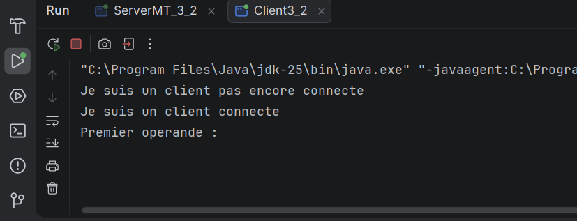

### 7.3 Résultat d'un calcul

Exemple de multiplication de `55` par `25`. Le client affiche la réponse
renvoyée par le serveur.

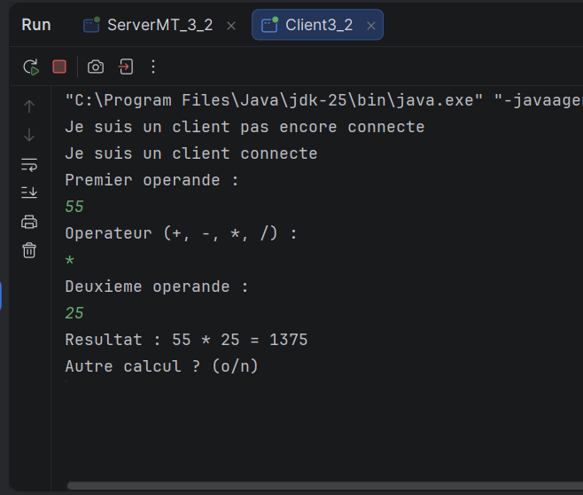

### 7.4 Affichage du compteur global

Après chaque objet `Operation` traité, le serveur affiche le nombre
total d'opérations comptabilisées.

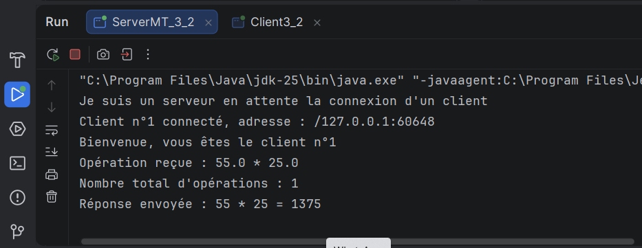
### 7.5 Plusieurs clients

Lancer plusieurs clients permet de vérifier que le serveur accepte
plusieurs connexions et que chaque client est traité par un thread
dédié. Le compteur d'opérations est commun à ces threads.

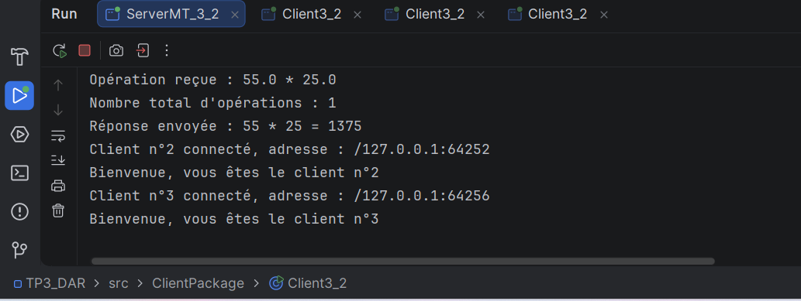
### 7.6 Fin de la communication

Lorsque l'utilisateur répond `n` à la question « Autre calcul ? », le
client envoie `"FIN"` et ferme sa connexion.

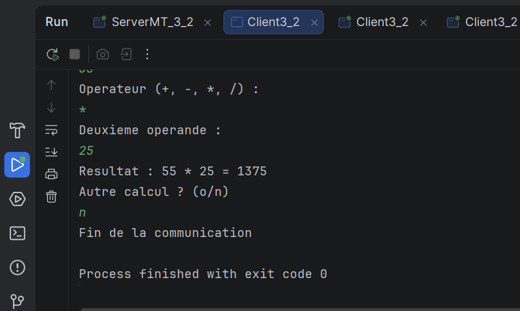
### 7.7 resultat serveur :
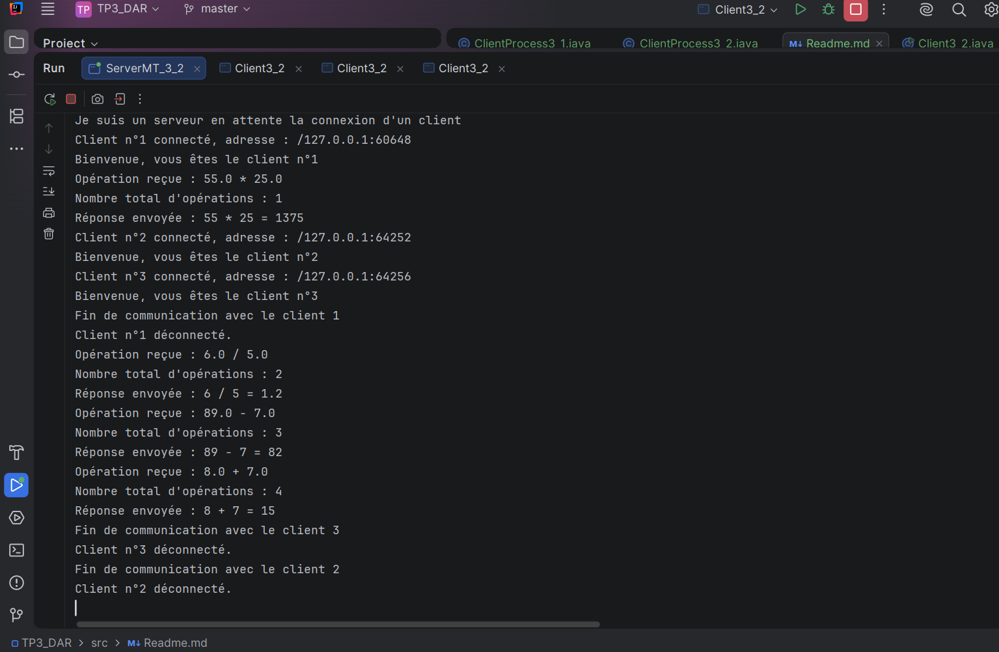
## 8. Tests à réaliser

  -----------------------------------------------------------------------
Test                    Action                  Résultat attendu
  ----------------------- ----------------------- -----------------------
Connexion               Démarrer le serveur     Le client se connecte
puis le client          au port `1234`

Addition                Saisir `10`, `+`, `5`   Le serveur renvoie
`10 + 5 = 15`

Soustraction            Saisir `10`, `-`, `5`   Le serveur renvoie
`10 - 5 = 5`

Multiplication          Saisir `55`, `*`, `25`  Le serveur renvoie
`55 * 25 = 1375`

Division                Saisir `10`, `/`, `2`   Le serveur renvoie
`10 / 2 = 5`

Division par zéro       Saisir `10`, `/`, `0`   Un message d'erreur est
renvoyé

Fin de communication    Répondre `n` à « Autre  Le client envoie
calcul ? »              `"FIN"` et se
déconnecte

Compteur                Effectuer plusieurs     Le compteur augmente
opérations              après chaque opération
traitée

Plusieurs clients       Lancer plusieurs        Le serveur accepte
clients                 plusieurs connexions et
partage le compteur
entre les threads
  -----------------------------------------------------------------------

## 9. Comparaison entre les activités 3-1 et 3-2

  -----------------------------------------------------------------------
Élément                 Activité 3-1            Activité 3-2
  ----------------------- ----------------------- -----------------------
Communication           Chaînes de caractères   Objets Java sérialisés

Flux utilisés           `BufferedReader` et     `ObjectInputStream` et
`PrintWriter`           `ObjectOutputStream`

Données d'une opération Valeurs envoyées        Objet `Operation`
séparément

Réponse au client       Texte                   Texte (`String`) dans
cette version

Serveur multithread     Oui                     Oui

Compteur global         Non demandé dans la     Ajouté dans cette
synchronisé             version 3-1 présentée   activité

Fin de communication    Commande texte, selon   Objet chaîne `"FIN"`
l'implémentation
  -----------------------------------------------------------------------

## 10. Exécution du programme

1.  Vérifier que `Operation.java` se trouve dans `commonPackage` et
    implémente `Serializable`.
2.  Vérifier que le constructeur et les getters de `Operation`
    correspondent au code du client et du serveur.
3.  Vérifier que les trois classes utilisent le même port, `1234`.
4.  Lancer `ServerMT_3_2.java`.
5.  Lancer `Client3_2.java`.
6.  Effectuer plusieurs calculs et vérifier les résultats.
7.  Vérifier dans la console du serveur que le compteur augmente.
8.  Lancer une deuxième instance du client pour tester plusieurs
    connexions.
9.  Ajouter les captures d'écran réelles au dossier `captures/`.

Pour tester sur deux ordinateurs d'un même réseau local, remplacer
`localhost` dans `Client3_2.java` par l'adresse IP locale de
l'ordinateur serveur. Vérifier aussi que le port `1234` est autorisé par
le pare-feu et que les deux ordinateurs peuvent communiquer.

## 11. Synthèse et conclusion

L'activité 3-2 améliore l'application de l'activité 3-1 en remplaçant
l'échange de plusieurs chaînes par la transmission d'un objet
`Operation`. Les flux `ObjectOutputStream` et `ObjectInputStream`
assurent l'envoi et la réception des objets Java.

Le serveur reste multithread : chaque client est traité par un thread
indépendant. L'ajout du compteur global synchronisé permet de
comptabiliser les opérations traitées par l'ensemble des clients sans
perdre d'incréments à cause d'accès concurrents.

Les tests doivent confirmer le bon fonctionnement des quatre opérations
arithmétiques, le traitement de la division par zéro, la fin de
communication avec `"FIN"`, l'incrémentation du compteur et la prise en
charge de plusieurs clients.

